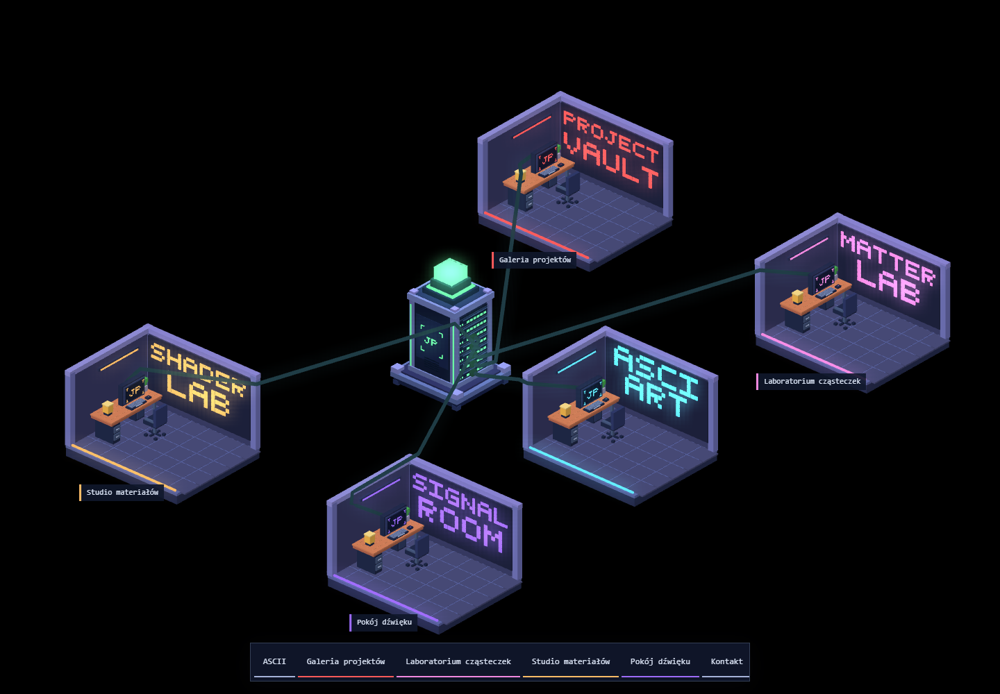

# Cztery nowe pokoje — implementacja i weryfikacja

**Aktualizacja:** wygląd i aplikacje opisane niżej pozostają aktualne.
Limit 30 FPS z wcześniejszego etapu zastępuje natywny RAF i budżet idle 60 FPS:
[pomiary i ograniczenia](idle-performance.md).
Opis sztywnych tras kabli, ich stałych długości/czasów oraz dawne liczby
trójkątów zostały zastąpione przez [giętkie kable i przenoszenie](flexible-cables.md).
Poniższe szczegóły tras dokumentują wcześniejszy etap, nie bieżący solver.

Zrealizowano lokalnie 16 listopada 2026. Podgląd: `http://localhost:8000`.
Bez publikacji, push i rzeczywistych wiadomości do Web3Forms.

## Obsługa

Kliknij konkretną wyspę lub wybierz pokój z dolnego, przewijanego paska.
Kamera przybliży monitor komputera, dokładnie jak w pokoju ASCII. Cały projekt
otwiera się na jego ekranie: opis, kontrolki i podgląd WebGL. Nie ma zewnętrznego
panelu ani aktywnego eksperymentu poza ekranem.
Przyciski działają przez Enter/spację oraz dotyk. Powrót: przycisk albo Escape,
również podczas niedokończonego wejścia. Fokus wraca do wybranego wejścia.

| Pokój | Działające funkcje |
|---|---|
| Galeria projektów | Aplikacja na monitorze otwiera rzeczywiste case study JP Creative Lab; opis, funkcje, technologie i bezpieczny odnośnik do repo. Dane w `projects.js`. |
| Laboratorium cząsteczek | 2000 punktów desktop / 750 poniżej 700 px; Orbita, JP, Fala, interpolacja, odpychanie kursorem/dotykiem, siła i reset. |
| Studio materiałów | Prawdziwa rzeźba 3D z deformacją; proceduralny Chrom, Hologram i barycentryczna Siatka. Kolor światła zmienia rzeźbę na monitorze, nie stałe akcenty pokoju. Reset. |
| Pokój dźwięku | Dwie syntezowane ścieżki, po 8 kroków: stopa i hi-hat. Start/Stop, tempo 60–160 BPM, głośność 0–0,3, wyciszenie i wizualizacja z zegara audio. |

Każdy pokój ma własną geometrię, odbiornik kabla, kolor i cel kamery.
Kable reagują na uniesienie wyspy i serwera. Wejście nie zmienia prędkości wiązek;
wizualizator na monitorze pokoju dźwięku korzysta z zegara audio.

Kable odpowiadają wzorcowi ASCII: przekrój 0,17, dwa świetlne tory 0,085,
złączki 0,205 i fizyczne wtyczki. Nowe połączenia wychodzą z osobnych półek
na ścianie **+X** racka, omijają ściany oraz koniec biurka i wchodzą w tył
monitora. Panel [JP] na ścianie +Z pozostaje wyłącznie kontaktem.
Serwer wysyła po powierzchni przewodu zieloną smugę; pokój odpowiada własnym kolorem.
Nie ma osobnych białych klocków udających sygnał ani gniazd w podłodze.
Poświata respektuje głębię: ściany i sprzęt zasłaniają kabel.

### Kolory, odstępy i wspólna prędkość

ASCII pozostaje cyjanowy. Galeria jest czerwona (`#ff5a5a`), cząsteczki
różowe (`#f189e0`), materiały bursztynowe (`#ffbc67`), dźwięk fioletowy
(`#9e6bff`). Zielony jest zarezerwowany dla sygnałów serwera.

| Pokój | Środek wyspy | Długość kabla | Odbiór w pokoju | Odbiór odpowiedzi w serwerze |
|---|---|---|---|---|
| Galeria | [-10,0,-14] | 42,003 | 9,401 s | 18,801 s |
| Cząsteczki | [6,0,-14] | 60,083 | 13,017 s | 26,033 s |
| Materiały | [-10,0,13] | 42,543 | 9,509 s | 19,017 s |
| Dźwięk | [6,0,14] | 61,623 | 13,325 s | 26,649 s |

Każda wiązka ma prędkość **5 jednostek sceny/s**, niezależnie od długości
kabla. Serwer rozpoczyna wysyłkę w 1 s cyklu, pokój odpowiada sekundę
po odbiorze. Wspólny cykl wynosi około **28,649 s** i czeka na najdłuższą trasę.
Zielony rozbłysk pokoju następuje dopiero po dotarciu wiązki; serwer i kryształ
rozbłyskują kolorem otrzymanej odpowiedzi. Przy nakładaniu odbiorów wygrywa
ostatnie dotarcie, bez mieszania kolorów. Obudowy nie zmieniają barwy.

Po korekcie wyglądu wszystkie cztery pokoje nawiązują do pierwszego ASCII:
dwie pełne ściany z fioletowym obramowaniem, drewniane biurko z szufladami,
komputer z napisem JP, klawiatura, mysz, fotel, lampka i roślina.
Duże dwuwierszowe napisy wykorzystują ten sam pięciowierszowy alfabet voxel
co oryginalne „ASCI ART”: PROJECT / VAULT, MATTER / LAB, SHADER / LAB,
SIGNAL / ROOM. Każdy pokój zachowuje osobny kolor i własny eksperyment.
Wszystkie aplikacje pokrywają rzeczywiste monitory przy biurkach.
Na życzenie użytkownika usunięto dodatkowe modele z wnętrz: podesty,
mini-serwer, kulę, chmurę punktów i sprzęt muzyczny. Zostały stanowiska
komputerowe, napisy i kolorowe akcenty. Cząsteczki, materiały i wizualizator
działają wyłącznie w aplikacjach na ekranach, także bez modeli w widoku ogólnym.

ASCII i kontakt na ścianie **+Z z napisem [JP]** pozostały funkcjonalne.
Publiczna konfiguracja Web3Forms nie została zmieniona.

### Ujednolicenie ASCII

Na polecenie użytkownika również ASCII korzysta teraz z tego samego `buildRoom`,
wyposażenia i shadera co cztery nowe pokoje. Podłoga ma ten sam rozmiar i siatkę,
ściany tę samą wysokość, a biurko, komputer, fotel oraz oświetlenie ten sam model.
Zachowano cyjan, napis ASCI / ART, konwerter, nawigację i fokus.
Centrum ASCII: `[4.985,0,.04]`. Kamera i HTML pasują do wspólnego ekranu
`LAB_MONITOR` (1,20 × 0,76); rzeczywista projekcja jest sprawdzana w trzech rozmiarach.

Kabel ASCII ma ten sam przekrój, złączki, tory świetlne i shader co pozostałe.
Wychodzi z najniższej półki `[-3.43,.727,.20]`, omija koniec lewej ściany
i wchodzi w tył monitora. Długość **18,408**, odbiór w pokoju **4,682 s**,
odpowiedź dociera do racka w **9,363 s** wspólnego cyklu.
`scene-geometry.js` wyklucza z obu przebiegów stary pokój i kabel GLB;
nie ma podwójnej geometrii ani starego świecącego przewodu. Sam GLB jest bez zmian.

## Architektura i zachowanie

- Jeden canvas, kontekst WebGL2, kamera i pętla renderowania z limitem 30 FPS.
- `rooms.js`: cztery aplikacje w `ROOMS`, ASCII w `ASCII_ROOM`, wszystkie pięć
  wysp w `WORLD_ROOMS`, granice świata i responsywne kadrowanie.
- `LAB_MONITOR` i `labMonitorFrame` są wspólnym źródłem powierzchni ekranu,
  kierunku +X kamery i wymiarów HTML. Fotel odjeżdża jak w ASCII.
- `room-world.js`: statyczne wyspy i kable, bez uruchamiania generatora GLB.
- `cables.js`: trasy rack–monitor, wymiary wzorca ASCII, odległości wzdłuż
  przewodu, zakotwiczenie końców i kolory transmisji.
- `signals.js`: wspólna prędkość, zegar sieci, czasy dotarcia i wybór koloru
  odbioru; ten sam stan trafia do renderera GLB i nowych pokoi.
- `lab-renderer.js`: GPU, punkty, GLSL materiałów i wizualizacja rytmu.
- `lab-particles.js`: deterministyczne współrzędne trzech układów.
- `lab-ui.js`, `lab.css`: semantyczne kontrolki, fokus, hitboxy i panele.
- `lab-audio.js`: leniwy AudioContext, synteza i pojedynczy scheduler look-ahead.
- Nieaktywne eksperymenty nie mają osobnych pętli symulacji.
- Niewidoczna karta nie utrzymuje RAF ani uruchomionego audio.
- Dźwięk wymaga świadomego Start. Wyjście, ukrycie i utrata WebGL go zatrzymują.
  Powrót nie uruchamia go ponownie. Niedokończony Start można anulować.
- Reduced motion: statyczne kształty i brak przejazdów/unoszenia; kontrolki
  pozostają aktywne, a dźwięk nadal wymaga Start.
- Cała aplikacja mieści się w fizycznym monitorze. Podgląd GPU i przewijane
  sterowanie są wewnętrznym układem aplikacji, również na telefonie.
  WebGL viewport/scissor przycina podgląd do tego ekranu i przywraca stan GPU.
  W widoku ogólnym telefon ma wyższą kamerę, żeby świat wypełniał pion.
- Zachowano ciemny wynik kompozycji istniejącego renderera, zamiast zmieniać
  wygląd oryginalnego ASCII/racka na jasny motyw przewidywany w szkicu planu.
- Nowa statyczna geometria wraz z kablami: **15904 trójkąty** (budżet 16000).
  Rzeźba w aplikacji monitora to 1920 trójkątów. Bufory punktów są ponownie używane.
  Po zastąpieniu starego ASCII łączna geometria pięciu proceduralnych pokoi
  i kabli wynosi **19346 trójkątów**; GLB dostarcza już tylko rack.

## Powtarzalne testy

Serwer HTTP musi działać z katalogu projektu:

```powershell
python -m http.server 8000 --bind 127.0.0.1
```

Logika i geometria:

```powershell
node --test tests/*.test.mjs
python tests/test_cable.py
```

Playwright jest zależnością wyłącznie testową, nie aplikacji. Na tym komputerze:

```powershell
$env:NODE_PATH = 'C:\Users\Kuba\AppData\Local\Temp\opencode\jp-browser-tests\node_modules'
node tests/four-rooms.cjs
node tests/browser-regression.cjs
```

Uruchamiać **szeregowo**: nie uruchamiać równolegle procesów programowego WebGL.
Na innym komputerze ustaw `NODE_PATH` na katalog `node_modules` z Playwright
i `JP_BROWSER` na plik wykonywalny przeglądarki. Opcjonalne `JP_TEST_URL`
i `JP_TEST_OUTPUT` zmieniają serwer oraz katalog dowodów.

Testy obu runnerów blokują prawdziwe żądania do dostawcy poczty.
Konfiguracja kontaktu jest testowana atrapami.

## Wynik końcowy

Środowisko: Windows, headless Edge, ANGLE SwiftShader, DPR 1.
Rozmiary: **1440×1000**, **390×844**, **844×390**; dodatkowo test animacji,
klawiatury i utraty kontekstu przy 1100×850.

| Sprawdzenie | Wynik |
|---|---|
| Node, logika, wyposażenie, kamery i giętkie kable | **36 PASS, 0 FAIL** |
| Python, istniejąca geometria kabla | **8 PASS, 0 FAIL** |
| Nowe pokoje, WebGL/Audio/mobile/lifecycle | **14 grup wyników, 0 błędów** |
| Fixture przeglądarkowe wraz z kolorowymi kablami | **11 scenariuszy, 195 asercji, 0 błędów** |

Dowody nie ograniczają się do DOM:

- Rzeczywiste macierze kamery wskazują środek monitora każdego pokoju wzdłuż +X.
  Wszystkie cztery krawędzie HTML pokrywają projekcję fizycznego ekranu z błędem
  poniżej 1 px w trzech rozmiarach. Kontakt nadal patrzy na panel +Z.
- Orbita → JP zmienia **17627 pikseli** desktop / **3339** na telefonie.
  JP → Fala: **15106 / 2587**. Odpychanie kursorem: **6425 / 693**.
- Chrom → Hologram: **74358 / 5434** zmienionych pikseli.
  Hologram → Siatka: **73760 / 5404**. Deformacja także zmienia piksele.
- Zmiana eksperymentu nie zmienia pikseli poza podglądem monitora; po każdym
  renderze viewport ma rozmiar całego canvas, a scissor jest wyłączony.
- Przed Start: **0 AudioContext**. Po Start: **1 kontekst**, prawdziwe
  źródła i niezerowy sygnał zmierzony przez `AnalyserNode`.
  Wyciszenie daje ciszę; wyjście, ukrycie i utrata WebGL zawieszają kontekst.
- Sprawdzono aplikację galerii na monitorze, rzeczywiste kliknięcia/dotyk wysp,
  Enter/spację dla wszystkich czterech wejść, powrót fokusu i przerwane wejście.
- Reduced motion daje identyczne piksele przy kolejnym renderze bez zmiany
  parametrów. Zmiana szerokości aktualizuje limit 2000/750 bez nowego kontekstu.
- Brak poziomego przepełnienia paneli; brak błędów JS/console w trzech rozmiarach.
- Wciąż przechodzą testy ASCII, krzesła, logo, transmisji, bloom i kontaktu.
  Test animacji korzysta ze wspólnych granic świata, zachowując wszystkie asercje.
- `tests/cables.html`: **36 asercji pikselowych dla pięciu kabli** potwierdza zieloną wysyłkę,
  odpowiedzi w kolorach pokoi, ruch, dotarcie do wtyczek racka, kolor kryształu,
  zielony odbiór pokoju dopiero po dotarciu i dokładny powrót do stanu spoczynkowego.
  Kontrolowany zegar korzysta z fizycznych czasów każdej trasy.
- `tests/signal-network.test.mjs`: wspólna prędkość w obu kierunkach na pięciu
  trasach, przyczynowe odbiory, ostatnie dotarcie, różne kolory i odstępy wysp.
- `tests/ascii-room.test.mjs`: identyczna bryła i wyposażenie, nowe końce kabla,
  zakotwiczenie oraz faktyczne wykluczenie starego pokoju/kabla z indeksów GLB.

Oryginalny GLB jest identyczny bajt w bajt z `HEAD`.
SHA-256: `8b4b82ab815b34eb73dff520e89edc535eff9745642c20cdfb87effd081f3f18`.

Zrzuty i surowe wyniki: [four-rooms-evidence](four-rooms-evidence/).



## Granice weryfikacji

- To testy w emulowanych rozmiarach, nie na fizycznym telefonie.
- Nie wykonywano odsłuchu fizycznych głośników ani pomiaru wydajności na GPU
  użytkownika. 30 FPS to limit pętli, nie gwarancja dla każdego urządzenia.
- Ukrycie dokumentu zasymulowano przez `visibilitychange`; utrata WebGL była
  rzeczywista, przez `WEBGL_lose_context`. Audio i jego analizator były rzeczywiste.
- Nie wykonano prawdziwego wysłania maila, push ani wdrożenia.
- Jeden zimny przebieg fixture kontaktu przekroczył wewnętrzny limit gotowości
  renderera (6 s), bez błędu JS. Bez zmiany limitu: pięć kolejnych uruchomień
  tego fixture oraz ponowny pełny zestaw przeszły. Nie zamaskowano tego ponawianiem
  wewnątrz runnera.
